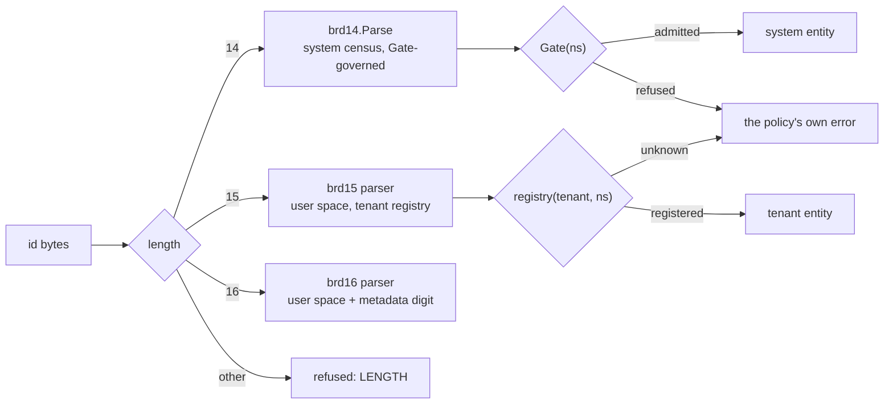
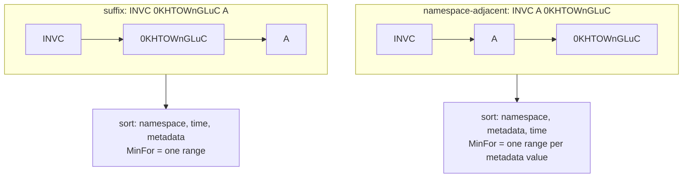
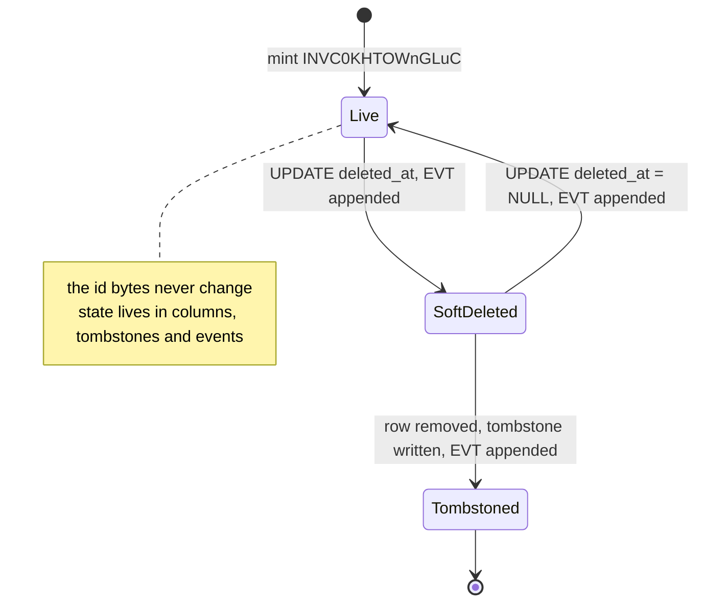

# Namespaces and Storage: brd14 vs brd16 { id="namespaces-and-storage" }

> *Where the three-letter system census ends and the four-letter user space begins, what one metadata character would do to an id's identity, and what 14 versus 16 bytes costs in PostgreSQL, SQLite, Redis and five runtimes, measured.*

## The Setup

A brd14 namespace is three uppercase letters, so the whole census is 26³ = 17,576 brands, and
every one of them is **system-reserved**: `USR`, `SES`, `JOB` are decided by the people who run
the platform and admitted by a `Gate` ([`go/minter.go`](../../go/minter.go)). The failure arrives
with the first tenant, plugin or Branded Component System (BCS) user who needs an entity type of
their own. Hand them a system brand and the census stops being a census: 17,576 is plenty for a
platform's own types and far too few to lease out, and nothing in the id tells system code which
brands it may trust. Fold a marker into the three letters (`U` + two letters, say) and the
discriminator is a convention, which means a brd14 parser accepts the user id, every call site has
to re-check the convention, and one of them eventually does not.

The workaround people reach for is to stop letting the id carry the type: a `kind` column beside
the id, or a lookup from the tenant's registry before any id is believed. That gives up the one
property the format exists for. The Operator's ask goes the other way and asks for more inside the
id: a four-letter namespace for user space, and a fifth character of metadata that could hold
"audit" or "deleted" or "dangling" flags, a small bitmap, whatever a design needs. Both halves of
that ask deserve a real answer, including the uncomfortable part: a flag that changes after mint
is not metadata, it is a second identity.

By the end of this article you will have the family laid out by **width** (brd14 = 14 bytes,
system; brd15 = 15, user space; brd16 = 16, user space plus one metadata digit) with the parser
argument for why width and not a prefix is the discriminator; a steelman and then a verdict on the
metadata digit, with the placement that keeps `MinFor` range scans working and the list of what
may live in it; measured bytes per row and per key for every sensible storage representation in
PostgreSQL 16, SQLite 3.45 and Redis 7, with MySQL, ClickHouse, Valkey and the BEAM cited; the
collation traps, each one executed; and a decision table.

## What You'll Build

- The width-discriminated format family, with the `LENGTH`-first parser argument and the census
  (system) versus registry (user space) governance that goes with it.
- A verdict on the brd16 metadata character: placement, capacity, what it may encode, and why it
  must be fixed at mint time, with the mutable-state patterns (column, tombstone, audit event)
  shown as executed SQL.
- A per-engine storage guide, PostgreSQL 16 and SQLite 3.45 measured, MySQL 8 and ClickHouse
  cited, with the `BIGINT`, `text COLLATE "C"`, `bytea`, composite and UUID-packed options priced.
- The collation traps per engine: linguistic ordering, nondeterministic equality against a
  `UNIQUE` index, `LIKE` and index use, and the one-line schema audit that catches them.
- A memory table for 14 versus 16 bytes across Go 1.26, CPython 3.14 and 3.14t, Node 24, Bun
  1.4, Redis 7 (measured) and the BEAM and Valkey 9 (cited).
- A decision table (brd14, brd15, brd16, `BIGINT` column) by use case, and the 14-vs-brd16
  summary in numbers.

Every number below is read from [`tools/storage_probe/results.json`](../../tools/storage_probe/results.json),
written by one run of `python3 tools/storage_probe/run.py` (PostgreSQL 16.15, Redis 7.0.15, SQLite
3.45.1, Go 1.26.9, CPython 3.14.8, Node 24.21.0, Bun 1.4.3; N = 1,000,000 rows, keys or strings
per representation; one 4-vCPU Linux box; 66.7 s for the whole run, temporary servers started and
removed by the probe). A number that was not measured is marked **cited**
with its source. Every SQL statement quoted here was executed by that probe and is in the file's
`postgresql.sql_log`.

This article uses these branded id namespaces:

| Namespace | Format | Entity | Example |
|---|---|---|---|
| `USR` | brd14 | user, a system brand | `USR0KHTOWnGLuC` |
| `SES` | brd14 | session, a system brand | `SES0KHTOWnGLuD` |
| `JOB` | brd14 | EchoMQ job, a system brand | `JOB0KHTOWnGLuE` |
| `EVT` | brd14 | audit event, a system brand | `EVT0KHTPgKLBWy` |
| `INVC` | brd15 | a tenant-defined invoice, user space | `INVC0KHTOWnGLuC` |
| `INVC` + `A` | brd16 | the same entity type with a mint-time kind digit | `INVCA0KHTOWnGLuC` |

`USR0KHTOWnGLuC` is the contract's V-1 vector: snowflake `274557032793636864`, minted
2026-01-27T15:11:37.641Z. The probe's corpus starts in that millisecond on node 585 (the N-1
vector) and mints 1,000,000 consecutive ids, 64 per millisecond, `USR0KHTOWnQPFw` through
`USR0KHTPgKLBWx`, so every table, key set and heap in this article holds the same ids.

## The Family, Discriminated by Width

The contract reserves two more formats next to brd14 and gives each its own length. The length is
the whole point.

| Format | Length | Namespace | Payload | Space | Status |
|---|---:|---|---|---|---|
| brd14 | 14 | 3 × `[A-Z]` | 11 × base62 | **system**: 26³ = 17,576 brands | frozen, implemented |
| brd15 | 15 | 4 × `[A-Z]` | 11 × base62 | **user**: 26⁴ = 456,976 brands | reserved |
| brd16 | 16 | 4 × `[A-Z]` + 1 metadata digit | 11 × base62 | user, with 62 metadata values | reserved |

The payload is the same 63-bit snowflake in the same fixed-width base62, so the epoch, the byte
order equals numeric order law, and `MinFor` carry over unchanged. What changes is who may mint
and who will parse.

### Why width, not a prefix

A brd14 decoder checks `LENGTH` before anything else; the contract fixes the precedence as
`LENGTH → NAMESPACE → CHARSET → RANGE`. So a 15- or 16-byte id is refused by every brd14
implementation, in every language, before the namespace is even looked at, and a brd15 decoder
refuses a 14-byte id the same way. System code that parses with brd14 **cannot** accept a
user-space id by accident, and there is no call-site discipline involved: the refusal is in the
codec that every call site already uses.

```go
// Dispatch by width. Only the 14-byte arm exists today; the others are the door.
// Imports omitted: "fmt" and brd14 "github.com/jonny-novikov/brd14/go".
func classify(id string) (string, error) {
	switch len(id) {
	case brd14.Len: // 14: the system census
		ns, _, err := brd14.Parse(id)
		if err != nil {
			return "", err // errors.Is(err, brd14.ErrInvalid)
		}
		return ns, nil
	case 15, 16: // brd15 / brd16: user space, a different package when it exists
		return "", fmt.Errorf("user-space id %q: not accepted here", id)
	default:
		return "", brd14.ErrInvalid
	}
}
```

Compare the prefix alternative: carve user space out of the three letters, say every brand
starting with `U` is a tenant's. `brd14.Parse("UAB0KHTOWnGLuC")` succeeds, returns `"UAB"`, and
the decision whether `UAB` may be trusted moves to whoever called `Parse`. The census becomes 25 ×
26² = 16,900 system brands and 676 user brands, the parser proves nothing, and the first service
that forgets the `U` rule has a confused-deputy bug. Width makes the distinction structural, the
parser enforces it for free, and the user space gets 456,976 brands instead of 676.



### The census and the registry

brd14 ships no namespaces; which brands exist is policy, and the `Gate` is where the policy plugs
in. The system census is a closed set, small enough to be a literal:

```go
var census = map[string]bool{"USR": true, "SES": true, "JOB": true, "EVT": true}

g := brd14.NewGenerator(brd14.DefaultNode())
m := brd14.NewMinter(g, func(ns string) error {
	if !census[ns] {
		return fmt.Errorf("refusing to mint %q: not in the system census", ns)
	}
	return nil
})

id, err := m.Mint("USR") // "USR0KHTOWnGLuC"
_, err = m.Mint("ZZZ")   // the census error, returned unchanged
```

The gate runs first, on the raw namespace, so the refusal names the brand in the policy's own words
rather than collapsing into `ErrInvalid`. On the BEAM the same decision is a pure function, which
is what makes it cheap to call on every mint:

```elixir
defmodule Msh.Brands.Census do
  @moduledoc "The system census: three uppercase letters, a closed set."

  @census MapSet.new(~w(USR SES JOB EVT))

  @spec gate(String.t()) :: :ok | {:error, {:unregistered_brand, String.t()}}
  def gate(<<a, b, c>> = ns) when a in ?A..?Z and b in ?A..?Z and c in ?A..?Z do
    if MapSet.member?(@census, ns), do: :ok, else: {:error, {:unregistered_brand, ns}}
  end

  def gate(ns), do: {:error, {:unregistered_brand, ns}}
end
```

User space is governed differently, and the difference is the second half of the DX split. A
four-letter brand is **registered**, not enumerated: a tenant or plugin declares `INVC` once, with
an owner and a status, and the user-space minter's gate consults that registry. The registry is
data (a table, mirrored into ETS on the Echo node), the census is code, and neither can leak into
the other because their ids have different lengths. A registry row for a brand carries what the
census never needs: the owning tenant, a status (`active`, `frozen`, `retired`), the component
schemas that may attach to entities of that brand, and the moment it was registered.

| | System census (brd14) | User-space registry (brd15/brd16) |
|---|---|---|
| Brand shape | 3 × `[A-Z]` | 4 × `[A-Z]` |
| Who decides | platform | tenant / plugin, via registration |
| Where the policy lives | code: a `Gate` over a literal set | data: a status-keyed registry, cached |
| Refusal | the policy's own error, unchanged | the registry's own error (unknown, frozen, not yours) |
| Parser | brd14, refuses 15 and 16 bytes | brd15/brd16, refuses 14 bytes |
| Capacity | 17,576 | 456,976 brands, times 62 metadata values for brd16 |

### How BCS components key by id

In a Branded Component System the id is the entity, and components are keyed by it. A component
table, in PostgreSQL, SQLite or ETS, is a map from id to one component's data, and the brand is
what says which components may attach: `USR` entities get `profile` and `credentials`, `INVC`
entities get whatever the tenant declared when it registered the brand. Under width
discrimination the component store can hold both without ambiguity: a 14-byte key is a system
entity whose component set is known at compile time, a 15- or 16-byte key is a tenant entity whose
component set is read from the registry. Both are byte strings whose order is mint order, which
is what makes "every `INVC` entity since Tuesday" a range scan rather than a full pass.

*With the family and its governance in place, the remaining design question is the sixteenth byte.*

## One Metadata Character: the brd16 Door

The Operator's idea, stated as strongly as it deserves: an id travels everywhere the entity is
mentioned, in URLs, logs, cache keys, queue payloads, event streams, foreign keys. A fact folded
into the id travels with it for free, with no lookup, no join, no cache miss. One base62 digit is
62 values, which is a 62-way kind, or a 5-bit bitmap with 30 values to spare, or a check digit. A
reader that sees `INVCA0KHTOWnGLuC` knows the kind before it knows anything else, and a log line
that mentions a deleted entity says so in the id itself. The byte is cheap: the measurements
below show it is free in Go, Node and CPython and costs 8 bytes per PostgreSQL tuple. The idea is
not wrong; the question is what the digit may *mean*.

### Placement decides what a range scan means

The digit can sit next to the namespace (`INVC` `A` `0KHTOWnGLuC`) or after the payload (`INVC`
`0KHTOWnGLuC` `A`). Byte order equals time order within a namespace is a load-bearing property of
the family, because `MinFor(t)` turns "everything since *t*" into one half-open range. The probe
built both layouts from three snowflakes (first, middle and last of the corpus) and two metadata
values, and sorted them:

```sql
CREATE TABLE demo16_adjacent (id text COLLATE "C" PRIMARY KEY);
CREATE TABLE demo16_suffix (id text COLLATE "C" PRIMARY KEY);
SELECT string_agg(id, ' ' ORDER BY id) FROM demo16_adjacent;
SELECT string_agg(id, ' ' ORDER BY id) FROM demo16_suffix;
```

```text
adjacent: INVCA0KHTOWnQPFw INVCA0KHTP6YsnOS INVCA0KHTPgKLBWx INVCB0KHTOWnQPFw INVCB0KHTP6YsnOS INVCB0KHTPgKLBWx
suffix:   INVC0KHTOWnQPFwA INVC0KHTOWnQPFwB INVC0KHTP6YsnOSA INVC0KHTP6YsnOSB INVC0KHTPgKLBWxA INVC0KHTPgKLBWxB
```

Adjacent placement sorts metadata-major: all the `A` entities, then all the `B` entities, each
run in time order. Suffix placement keeps the whole namespace in time order and the digit only
breaks ties between the two ids of one snowflake. The consequence for `MinFor` is measurable. The
probe asked each table for the entities minted at or after the middle snowflake, where the right
answer is 4 (middle and last, times two metadata values):

```sql
SELECT count(*) FROM demo16_suffix   WHERE id >= 'INVC0KHTP6Yik2C';                             -- 4
SELECT count(*) FROM demo16_adjacent WHERE id >= 'INVCA0KHTP6Yik2C';                            -- 5
SELECT count(*) FROM demo16_adjacent WHERE (id >= 'INVCA0KHTP6Yik2C' AND id < 'INVCB') OR id >= 'INVCB0KHTP6Yik2C'; -- 4
```

With the suffix, one range is correct. With adjacent placement the naive range returns 5, because
every `B` entity, including the oldest, sorts after every `A` entity; the correct query is one
range **per metadata value**, 62 ranges in the worst case, 32 for a 5-bit bitmap. Adjacent
placement buys the opposite scan, "every entity of kind `A` since *t*" as one range, so the choice
is a statement about which scan matters more. For a namespace whose metadata is a small closed
kind set and whose consumers query by kind, adjacent is the right order. For everything else, and
for any digit that is a bitmap, the suffix keeps `MinFor` a single cursor and the digit stays out
of the sort key's way.



### Capacity

One base62 digit is log₂ 62 = 5.954 bits. The honest ways to spend it:

| Encoding | Values | Spare | Use |
|---|---:|---:|---|
| a kind enum | 62 | 0 | sub-types of one brand: `INVC` kinds `A` draft, `B` issued, `C` credit note |
| a 5-bit bitmap | 32 | 30 | five independent boolean facts, fixed at mint |
| a 4-bit bitmap + 1 bit | 32 | 30 | four flags and a parity bit over them |
| a check digit | 62 | 0 | sum of the other 15 bytes' alphabet indices mod 62; catches every single-character substitution |
| a format revision | 62 | 0 | which decoding rules apply to the payload, if the payload ever needs a second layout |

A check digit deserves a note: a plain sum mod 62 detects any one wrong character, because a
single substitution changes the sum by a value in 1..61, which is never 0 mod 62. It does not
detect every transposition of two adjacent characters; weighted schemes do, and 62 is not prime,
so the weights need choosing. That is a design in its own right, not a free byte.

### An id is an identity

Now the uncomfortable part. The examples in the ask were "deleted", "dangling", audit flags:
facts that are **false at mint and become true later**. Put such a fact in the id and the id
changes when the fact does, and an id that changes is two ids. Every place that held the old
bytes now holds a reference to nothing: the foreign key in another table, the key in Redis, the
path in a URL someone bookmarked, the id in yesterday's log line, the subject of an event already
in the stream. The `UNIQUE` index that is supposed to guarantee one row per entity happily holds
`INVCA0KHTOWnGLuC` and `INVCB0KHTOWnGLuC` side by side, because to the index they *are* two
entities. Equality breaks: `a == b` is false for the same invoice. Caches keyed by the id serve the
old state forever, because nothing ever invalidates a key that is never written again. And the
flag cannot be trusted anyway, since the id in a log line is a copy taken at some moment and says
nothing about now.

So the rule for the sixteenth byte is the same rule the first fifteen already obey: **everything
in the id is fixed at mint**. The namespace does not change, the snowflake does not change, and
the metadata digit may hold only what is known when the snowflake is drawn and will never be
different:

- the **kind** of the entity within its brand (draft vs issued is a kind only if an issued invoice
  is a new entity; if a draft *becomes* issued, that is state, see below);
- the **audit class** or retention class the entity was created under;
- a **tenancy or shard hint**, when the entity's home is decided at mint and never moves;
- a **check digit** over the rest of the id;
- a **format revision** of the payload.

Mutable state goes next to the id, in exactly the places the id was going to point at anyway. The
probe built the three standard shapes on the 1,000,000-row corpus and exercised each:

```sql
CREATE TABLE invoices (id text COLLATE "C" PRIMARY KEY CHECK (length(id) = 14), deleted_at timestamptz);
INSERT INTO invoices SELECT id14, NULL FROM src ORDER BY snow;
CREATE INDEX invoices_live ON invoices (id) WHERE deleted_at IS NULL;
UPDATE invoices SET deleted_at = now() WHERE id = 'USR0KHTOWnQPFw';

CREATE TABLE tombstones (id text COLLATE "C" PRIMARY KEY, reason text NOT NULL, at timestamptz NOT NULL DEFAULT now());
INSERT INTO tombstones (id, reason) VALUES ('USR0KHTOWnQPFw', 'customer request');

CREATE TABLE audit_events (event_id text COLLATE "C" PRIMARY KEY, subject text COLLATE "C" NOT NULL, kind text NOT NULL, at timestamptz NOT NULL DEFAULT now());
CREATE INDEX audit_events_subject ON audit_events (subject, event_id);
INSERT INTO audit_events (event_id, subject, kind) VALUES ('EVT0KHTPgKLBWy', 'USR0KHTOWnQPFw', 'deleted');
```

Three shapes, three jobs. The **column with a partial index** answers "the live ones" at the cost
of one nullable column; after the soft delete, `SELECT count(*) FROM invoices WHERE deleted_at IS
NULL` returned 999,999, and the partial index over the live rows measured 31,563,776 bytes, the
same as `t_text14`'s primary key, since one row out of a million is missing from it. A range over
the newest ids uses it:

```sql
EXPLAIN (COSTS OFF) SELECT id FROM invoices WHERE deleted_at IS NULL AND id >= 'USR0KHTPfc3lEe';
```

```text
Index Only Scan using invoices_live on invoices
  Index Cond: (id >= 'USR0KHTPfc3lEe'::text)
```

The **tombstone** table is the right home for "deleted" when the row itself must go: it keeps the id
resolvable (`SELECT reason FROM tombstones WHERE id = 'USR0KHTOWnQPFw'` returned `customer
request`) without keeping the data. The **audit event** is itself an entity with its own brand and
its own snowflake, so the history of an id is a range scan on `(subject, event_id)`, in time order,
and "dangling" is a query over events rather than a bit:

```sql
SELECT kind || ' @ ' || at::date FROM audit_events WHERE subject = 'USR0KHTOWnQPFw' ORDER BY event_id;
-- deleted @ 2026-10-11
```



On the Echo side the same discipline is one Ecto schema and no cleverness:

```elixir
defmodule Msh.Billing.Invoice do
  use Ecto.Schema

  @primary_key {:id, :string, autogenerate: false}
  schema "invoices" do
    field :deleted_at, :utc_datetime_usec
  end
end
```

The id arrives already minted and already branded; the schema stores it as the string it is, and
"deleted" is a timestamp that can be set, unset and indexed without anyone re-keying a cache.

*The verdict on the digit is settled: mint-time facts only, suffix placement unless kind-major
scans are the workload. What the extra bytes cost in storage is the next question, and it is a
different answer per engine.*

## Storing Ids per Engine

Four representations compete for an id column: the integer snowflake in a `BIGINT`, with the
brand implied by the table; the branded string as is, in a text, char or binary column; a composite
of namespace and snowflake; and the whole thing packed into a 128-bit UUID. The probe built every
one of them with a primary key, loaded the same 1,000,000 ids in mint order, and measured.

### PostgreSQL 16, measured

The method, for one representation (the other thirteen differ only in the column definition and the
source expression):

```sql
CREATE EXTENSION pageinspect;
CREATE TABLE t_text14 (id text COLLATE "C" PRIMARY KEY);
INSERT INTO t_text14 SELECT id14 FROM src ORDER BY snow;
SELECT pg_relation_size('t_text14'), pg_relation_size('t_text14_pkey'), pg_total_relation_size('t_text14');
SELECT pg_column_size(id), pg_column_size(t_text14.*) FROM t_text14 LIMIT 1;
SELECT lp_len, count(*) FROM heap_page_items(get_raw_page('t_text14', 0)) GROUP BY lp_len ORDER BY lp_len;
SELECT itemlen, count(*) FROM bt_page_items('t_text14_pkey', 1) GROUP BY itemlen ORDER BY itemlen;
SELECT type, live_items, avg_item_size, page_size, free_size FROM bt_page_stats('t_text14_pkey', 1);
```

`pg_relation_size` divided by N is the bytes per row the engine actually spent; `lp_len` is the
heap tuple's length as stored; `itemlen` is the index tuple's. All fourteen tables, N = 1,000,000,
8 KiB pages:

| Representation | Column bytes | Heap tuple `lp_len` | Index `itemlen` | Heap B/row | Index B/row | Total B/row |
|---|---:|---:|---:|---:|---:|---:|
| `bigint` | 8 | 32 | 16 | 36.25 | 22.49 | 58.77 |
| `text COLLATE "C"`, 14 chars (brd14) | 15 | 39 | 24 | 44.29 | 31.56 | 75.89 |
| `text COLLATE "C"`, 15 chars (brd15) | 16 | 40 | 24 | 44.29 | 31.56 | 75.89 |
| `text COLLATE "C"`, 16 chars (brd16) | 17 | 41 | 32 | 52.18 | 40.62 | 92.85 |
| `varchar(14)` / `char(14)` | 15 | 39 | 24 | 44.29 | 31.56 | 75.88 |
| `varchar(16)` / `char(16)` | 17 | 41 | 32 | 52.18 | 40.62 | 92.84 |
| `bytea`, 14 bytes | 15 | 39 | 24 | 44.29 | 31.56 | 75.89 |
| `bytea`, 16 bytes | 17 | 41 | 32 | 52.18 | 40.62 | 92.85 |
| `uuid` (namespace, metadata and snowflake packed) | 16 | 40 | 24 | 44.29 | 31.56 | 75.88 |
| `(ns char(3), snow bigint)` | 4 + 8 | 40 | 24 | 44.29 | 31.56 | 75.88 |
| `(ns smallint, snow bigint)` | 2 + 8 | 40 | 24 | 44.29 | 31.56 | 75.88 |
| `text COLLATE "und-x-icu"`, 14 chars | 15 | 39 | 24 | 44.29 | 39.84 | 84.16 |

The arithmetic behind the table is the PostgreSQL page layout (cited: the heap tuple header is 23
bytes, each line pointer is 4, and user data starts at a MAXALIGN boundary, 8 bytes on this
platform; [storage-page-layout](https://www.postgresql.org/docs/16/storage-page-layout.html)). A
14-byte text value is stored with a 1-byte short varlena header, so it is 15 bytes
(`pg_column_size(id)` = 15). The heap tuple is 24 + 15 = 39 bytes (`lp_len`), occupies 40 on the
page after alignment, plus a 4-byte line pointer: 44 bytes, 185 rows per page, 44.29 bytes per row
measured. The index tuple is an 8-byte header plus 15 bytes of key, 23, aligned to 24 (`itemlen`),
plus its line pointer, 28; leaf pages filled to 262 live items with 812 bytes free, which is the
rightmost-page fill a sorted insert stream leaves behind, and 31.56 bytes per row measured.

Three facts fall out of the alignment:

- **brd15 is free in PostgreSQL.** Fifteen characters plus the short header are 16 bytes: the heap
  tuple is 40 bytes before and after alignment, and the index tuple is 8 + 16 = 24 exactly. Every
  number in the brd15 row equals the brd14 row.
- **brd16 pays 8 bytes twice.** Seventeen bytes of value make a 41-byte heap tuple that rounds to
  48, and a 25-byte index tuple that rounds to 32. Against brd14 that is +17.8% on the heap, +28.7%
  on the index, +22.3% in total: 16.96 bytes per row.
- **`uuid` and both composites cost exactly what brd14/brd15 cost.** A `uuid` is 16 bytes with no
  header; `(smallint, bigint)` is 2 bytes, 6 of alignment padding, then 8; `(char(3), bigint)` is
  4 + 4 padding + 8. All three are 16 bytes of key, so 24-byte index tuples and 40-byte heap tuples.
  The composite does not save bytes over the branded string; it changes what a join looks like.

`bigint` is the only representation that is cheaper: 8 bytes of key makes a 16-byte index tuple
and a 32-byte heap tuple, −18.2% heap, −28.7% index, −22.6% total against brd14. Scaled to
100,000,000 rows at the measured per-row figures (a formula, not a measurement: it assumes the same
fill), one id column with its primary key is 5.88 GB as `bigint`, 7.59 GB as brd14 or brd15 text,
and 9.29 GB as brd16 text. The sixteenth byte costs 1.70 GB per 100 million rows, 0.91 GB of it in
the index.

The last row of the table is the collation trap in storage form. The ICU-collated column holds the
same 15-byte values and the same 24-byte index tuples, yet its index is 26.2% larger, 39.84 against
31.56 bytes per row: the sampled leaf holds 192 live items with 2,772 bytes free. Mint order is not
index order under a linguistic collation, so the sorted insert stream is no longer an append at the
right edge, pages split in the middle, and the index carries the half-empty pages that leaves.

### The collation traps, executed

The alphabet is `0-9A-Za-z` in ASCII order, and byte order equals time order only while the
database compares bytes. The probe inserted 62 consecutive snowflakes, whose last payload digit walks
the whole alphabet, and sorted them twice:

```sql
CREATE TABLE ids62 (snow bigint PRIMARY KEY, id text COLLATE "C" NOT NULL);
SELECT string_agg(id, ' ' ORDER BY id COLLATE "C") FROM (SELECT id FROM ids62 ORDER BY id COLLATE "C" LIMIT 16) x;
SELECT string_agg(id, ' ' ORDER BY id COLLATE "und-x-icu") FROM (SELECT id FROM ids62 ORDER BY id COLLATE "und-x-icu" LIMIT 16) x;
```

```text
"C":         USR0KHTOWnGLu0 … USR0KHTOWnGLu9 USR0KHTOWnGLuA USR0KHTOWnGLuB USR0KHTOWnGLuC USR0KHTOWnGLuD USR0KHTOWnGLuE USR0KHTOWnGLuF
"und-x-icu": USR0KHTOWnGLu0 … USR0KHTOWnGLu9 USR0KHTOWnGLua USR0KHTOWnGLuA USR0KHTOWnGLub USR0KHTOWnGLuB USR0KHTOWnGLuc USR0KHTOWnGLuC
```

Under `"C"` the order is mint order (`SELECT array_agg(id ORDER BY id COLLATE "C") = array_agg(id
ORDER BY snow) FROM ids62` returned `t`). Under ICU's root locale, and under `"en-x-icu"`, lowercase
sorts before uppercase of the same letter and the letters interleave: `a A b B c C`, which is the
Unicode Collation Algorithm doing its job (cited: case is a tertiary-level difference,
[UTS #10](https://www.unicode.org/reports/tr10/)). The same query returned `f`. This box has no libc
`en_US.UTF-8` locale, so the linguistic side is ICU; `en-US-u-va-posix-x-icu`, ICU's POSIX
variant, sorted in mint order again. It is the exception that proves the rule: a collation is safe
for ids exactly when it compares code points, and only `"C"` promises that by definition.

At scale the divergence is almost total. Over the 1,000,000-row corpus:

```sql
SELECT count(*) FROM (SELECT row_number() OVER (ORDER BY id14 COLLATE "und-x-icu") AS by_text, row_number() OVER (ORDER BY snow) AS by_mint FROM src) x WHERE by_text <> by_mint;
```

returned 996,258 rows at a different position than mint order; the `"C"` version returned 0. The
`MinFor` cursor breaks with it. For the middle millisecond of the corpus, `MinFor` is snowflake
274557065559539712, payload `0KHTP6Yik2C`:

```sql
SELECT count(*) FROM t_bigint     WHERE id >= 274557065559539712;  -- 500032, the truth
SELECT count(*) FROM t_text14     WHERE id >= 'USR0KHTP6Yik2C';    -- 500032
SELECT count(*) FROM t_text14_icu WHERE id >= 'USR0KHTP6Yik2C';    -- 494528
```

The ICU column loses 5,504 rows from a half-open range that is supposed to be exact. Prefix
searches lose their index too:

```sql
EXPLAIN (COSTS OFF) SELECT id FROM t_text14 WHERE id LIKE 'USR0KHTOW%';
EXPLAIN (COSTS OFF) SELECT id FROM t_text14_icu WHERE id LIKE 'USR0KHTOW%';
```

```text
Index Only Scan using t_text14_pkey on t_text14
  Index Cond: ((id >= 'USR0KHTOW'::text) AND (id < 'USR0KHTOX'::text))
  Filter: (id ~~ 'USR0KHTOW%'::text)

Gather
  Workers Planned: 2
  ->  Parallel Seq Scan on t_text14_icu
        Filter: (id ~~ 'USR0KHTOW%'::text)
```

Under `"C"` the planner rewrites the `LIKE` prefix into a range and uses the primary key. Under
ICU it cannot, because a linguistic collation does not order prefixes bytewise; the documented
fix is a second index with `text_pattern_ops` (cited:
[indexes-opclass](https://www.postgresql.org/docs/16/indexes-opclass.html)), which the `"C"`
column never needs.

The sharpest trap is a **nondeterministic** collation, where equality itself stops being bytewise
(cited: "Nondeterministic comparison may determine strings to be equal even if they consist of
different bytes", [collation](https://www.postgresql.org/docs/16/collation.html)). The probe
created the documentation's own case-insensitive example and put a brd14 id through it:

```sql
CREATE COLLATION ci (provider = icu, locale = 'und-u-ks-level2', deterministic = false);
SELECT 'USR0KHTOWnGLuC' COLLATE ci = 'USR0KHTOWNGLUC';   -- t
CREATE TABLE t_ci (id text COLLATE ci PRIMARY KEY);
INSERT INTO t_ci VALUES ('USR0KHTOWnGLuC');
INSERT INTO t_ci VALUES ('USR0KHTOWNGLUC');
```

```text
ERROR:  duplicate key value violates unique constraint "t_ci_pkey"
DETAIL:  Key (id)=(USR0KHTOWNGLUC) already exists.
```

Two different snowflakes whose payloads differ only in case are one key to this index. Over the 62
consecutive ids, `SELECT count(DISTINCT id COLLATE "C"), count(DISTINCT id COLLATE ci) FROM ids62`
returned `62` and `36`: the 26 lowercase digits collapsed onto the uppercase ones. And `SELECT id
FROM t_ci WHERE id LIKE 'USR%'` fails outright with `nondeterministic collations are not supported
for LIKE`. The documentation also notes that B-tree deduplication is off for such indexes (cited,
same page).

The rule for PostgreSQL, then: declare every id column `COLLATE "C"` (or use `bytea`, which has no
collation to get wrong), never inherit the database default, and audit for it. The probe's audit is
one query over the catalog, and in the probe's own schema it found exactly the two columns that
were built to fail:

```sql
SELECT table_name || '.' || column_name || ' ' || data_type || ' ' || coalesce(collation_name, '(default)') FROM information_schema.columns WHERE table_schema = 'public' AND data_type IN ('text', 'character varying', 'character') AND (column_name = 'id' OR column_name LIKE '%\_id') AND collation_name IS DISTINCT FROM 'C' ORDER BY table_name, column_name;
```

```text
t_ci.id text ci
t_text14_icu.id text und-x-icu
```

### MySQL 8 / InnoDB, cited

MySQL was not measured here. Its trap is the default: the server character set and collation are
`utf8mb4` and `utf8mb4_0900_ai_ci` (cited: "By default, these are `utf8mb4` and
`utf8mb4_0900_ai_ci`", [charset-server](https://dev.mysql.com/doc/refman/8.0/en/charset-server.html)).
The `_ai_ci` suffix is accent- and case-insensitive, so a `VARCHAR(14)` id column created without
an explicit collation behaves like the PostgreSQL `ci` collation above: `USR0KHTOWnGLuC` and
`USR0KHTOWNGLUC` are one key, and the second `INSERT` into a `UNIQUE` column is a duplicate-key
error. That follows from the collation's definition; it was not executed in this probe.

The fix is to take the collation out of the column: `CHAR(14) CHARACTER SET ascii COLLATE
ascii_bin`, or `BINARY(14)`. Binary strings compare by byte value and have no notion of case
(cited: "The concept of lettercase does not apply to bytes in a binary string",
[charset-binary-collations](https://dev.mysql.com/doc/refman/8.0/en/charset-binary-collations.html)).
The same page notes that `BINARY(N)` pads shorter values with `0x00` and never strips on retrieval,
and that `utf8mb4_bin` is `PAD SPACE` while `utf8mb4_0900_bin` is `NO PAD`; for a fixed-width id
with no spaces neither detail bites, which is one more reason the fixed width is worth keeping. For
brd16 the same declarations read `CHAR(16)` and `BINARY(16)`. InnoDB row and index sizes for these
types were not measured and are not estimated here.

### SQLite 3.45, measured

Same corpus, same order, one database file per shape, measured as file bytes divided by N:

| Shape | DDL | B/row | Pages (4 KiB) |
|---|---|---:|---:|
| snowflake as rowid | `CREATE TABLE t (id INTEGER PRIMARY KEY)` | 14.09 | 3,441 |
| brd14, rowid table | `CREATE TABLE t (id TEXT PRIMARY KEY)` | 48.61 | 11,868 |
| brd16, rowid table | `CREATE TABLE t (id TEXT PRIMARY KEY)` | 52.79 | 12,888 |
| brd14 | `CREATE TABLE t (id TEXT PRIMARY KEY) WITHOUT ROWID` | 21.70 | 5,299 |
| brd15 | `CREATE TABLE t (id TEXT PRIMARY KEY) WITHOUT ROWID` | 22.92 | 5,595 |
| brd16 | `CREATE TABLE t (id TEXT PRIMARY KEY) WITHOUT ROWID` | 24.13 | 5,891 |
| brd14 as blob | `CREATE TABLE t (id BLOB PRIMARY KEY) WITHOUT ROWID` | 21.70 | 5,299 |
| brd16 as blob | `CREATE TABLE t (id BLOB PRIMARY KEY) WITHOUT ROWID` | 24.13 | 5,891 |
| composite | `CREATE TABLE t (ns TEXT NOT NULL, snow INTEGER NOT NULL, PRIMARY KEY (ns, snow)) WITHOUT ROWID` | 19.53 | 4,769 |

Two things to read off. A `TEXT PRIMARY KEY` on an ordinary rowid table is the expensive shape,
48.61 bytes per row, because the id is stored twice, once in the table and once in the automatic
index (cited: "the complete text of every 'word' is stored twice: once in the main table and again
in the index", [withoutrowid](https://www.sqlite.org/withoutrowid.html)); `WITHOUT ROWID` stores it
once, 21.70. And in SQLite the width is close to linear with no alignment cliff: brd15 costs 1.22
bytes per row more than brd14 and brd16 another 1.21, so 14 → 16 is +2.43 bytes per row, +11.2%.
`BLOB` and `TEXT` cost the same. SQLite's default `BINARY` collation compares bytes, so the
ordering traps above do not apply unless a column asks for `NOCASE`.

### ClickHouse, cited

Not measured. The natural column is `FixedString(14)`, "a fixed-length string of `N` bytes", stored
at exactly N bytes and documented as efficient when values are always exactly N bytes long (cited:
[FixedString](https://clickhouse.com/docs/en/sql-reference/data-types/fixedstring)); brd16 is
`FixedString(16)`. The page's two caveats, zero padding of shorter values and `=` ignoring trailing
`\0` while `LIKE` does not, do not arise for an id that is always full width. Where one table holds
one brand, `UInt64` for the snowflake with the brand implied by the table is the smaller column,
exactly as `BIGINT` is below.

### `BIGINT`: the brand implied by the column

When a table holds one entity type, the namespace is a property of the table, not of the row.
`users.id bigint` *is* `USR`; the brand is re-attached at the API edge, which brd14 makes cheap
(the Go reference encodes with no heap allocation on its `Append` path,
[architecture.md](../architecture.md)):

```go
// row.ID is the int64 the database returned; the table says which brand it carries.
id, err := brd14.Encode("USR", uint64(row.ID))
if err != nil {
	return fmt.Errorf("brand user row %d: %w", row.ID, err)
}
```

The measured cost of not doing this is the gap between the `bigint` row and the text rows above:
+17.1 bytes per row in PostgreSQL for brd14 text, +34.1 for brd16 text. Three cases keep the
branded string in the column regardless:

- a column that references entities of **more than one brand**: event subjects, component stores
  keyed by any entity, polymorphic links. A `bigint` there has lost the type, which is the one
  property the format exists to carry;
- a table whose rows are **user-space** entities, where the brand is tenant-registered data rather
  than a table name;
- any column that is **read by humans and tools** directly: logs, exports, support tooling.

The composite `(ns, snow)` buys back the bigint join at the same bytes as the string (measured:
40-byte heap tuples, 24-byte index tuples, identical to brd14 text), and the UUID packing fits the
largest family member with room to spare: 19 bits of four-letter namespace, 6 bits of metadata and
63 bits of snowflake are 88 of the 128 bits, bytewise order is namespace, metadata, time, and the
`uuid` column costs what brd14 text costs. Both are legitimate; neither is smaller.

*The engines priced, the remaining cost centre is memory: what the fourteenth versus sixteenth byte
does once the id is a string in a process.*

## Memory: 14 vs 16 Across Runtimes

The probe allocated 1,000,000 distinct strings of each width in each runtime, forced a collection,
and read the runtime's own accounting plus the process's resident set. One process per width, so
no reading reuses memory the other freed, and with `BUN_OPTIONS` and `NODE_OPTIONS` removed from
the environment (the file records what was cleared).

| Where | 14 bytes | 16 bytes | What was read | Δ |
|---|---:|---:|---|---:|
| Go 1.26.9, `string` | 16.0 B | 16.0 B | `HeapAlloc` delta / n; `BySize`: 1,000,000 mallocs in the 16-byte class for both; 17 bytes → 24.0 B in the 24 class | 0 |
| CPython 3.14.8, `str` | 55 B reported, 64.26 B RSS | 57 B reported, 64.26 B RSS | `sys.getsizeof`; RSS delta / n; pymalloc put 1,000,004 blocks in the 64-byte class for both | 0 |
| CPython 3.14.8, `bytes` | 47 B | 49 B | `sys.getsizeof` | 2 reported |
| CPython 3.14.8t (free-threaded), `str` | 71 B reported, 79.51 B RSS | 73 B reported, 79.51 B RSS | `sys.getsizeof`; RSS delta / n | 0 |
| Node 24.21.0, V8 13.6, pointer compression off (measured) | 32.0 B | 32.0 B | `process.memoryUsage().heapUsed` delta / n | 0 |
| Bun 1.4.3, JavaScriptCore | 30.02 B engine-reported, 100.79 B RSS | 32.01 B engine-reported, 100.33 B RSS | `bun:jsc heapStats().heapSize` delta / n; its extra-memory part is 14.01 vs 16.00, the character count itself | 0 in RSS |
| Redis 7.0.15, jemalloc 5.3.0, key | 56 B | 72 B | `MEMORY USAGE`; over 1,000,000 keys `used_memory` grew 56.37 vs 72.39 B/key, `MEMORY STATS keys.bytes-per-key` 56 vs 72 | +16 |
| PostgreSQL 16 index tuple | 24 B | 32 B | `bt_page_items` `itemlen` | +8 |
| PostgreSQL 16 heap tuple | 40 B | 48 B | `heap_page_items` `lp_len`, aligned | +8 |
| SQLite 3.45 `WITHOUT ROWID` row | 21.70 B | 24.13 B | file bytes / n | +2.43 |
| BEAM heap binary, **cited** | 3–6 words + 2 words of data | 3–6 words + 2 words of data | OTP efficiency guide, see below; not measured here | 0 words |
| Valkey 9, **cited** | — | — | the key no longer has its own allocation, see below; not measured here | — |

Where the sixteenth byte is free, it is free because an allocator rounds. Go's smallest classes are
8, 16, 24 and 32 bytes (the table is `runtime/sizeclasses.go` in the Go source); 14 and 16 both
land in 16, and the control string of 17 bytes lands in 24. pymalloc rounds a 55- or 57-byte object
to a 64-byte block, so the two bytes `sys.getsizeof` reports vanish by the time the process pays
for them. Node's figure is 32 for both and is consistent with a 16-byte string header plus the
characters rounded to 8. Bun's engine accounting is the one place a difference shows, and it is a
reporting artefact: JSC counts a string's character buffer at its exact length as "extra memory",
14.01 against 16.00 bytes per string, while the allocator underneath rounds that buffer the same
way the others do, which is why the resident set shows no difference beyond its own noise.

Where the byte costs, it costs because the id sits at a class or alignment boundary, and brd14
sits exactly on one in Redis. The probe swept `MEMORY USAGE` over key lengths 1 to 48 with the
value `1`: 48 bytes for 1–6 characters, 56 for 7–14, 72 for 15–30, 88 for 31–44, 104 from 45. The
steps are where a 1-byte sds header plus the terminating NUL cross jemalloc's small size classes
(cited: 8, then `[16, 32, 48, 64, 80, 96, 112, 128]`, [jemalloc(3)](https://jemalloc.net/jemalloc.3.html);
the 1-byte header is `sdshdr5` for strings under 32 characters in
[`sds.h`](https://github.com/redis/redis/blob/7.0/src/sds.h)): 1 + 14 + 1 = 16 bytes fits the
16-byte class exactly, 1 + 15 + 1 = 17 needs the 32-byte class. A 14-byte key is the longest key
that fits a 16-byte allocation on Redis 7, and brd15 and brd16 pay the same 16 bytes more per
key: 56.4 MB against 72.4 MB per million keys, +28.4%.

Valkey 9 is a different machine and the Redis numbers do not transfer. Valkey 8.0 embedded the key
in the dictionary entry (cited: "it can be embedded into the dictionary entry which has the same
lifetime as the former", "Reduces 8 bytes additional memory overhead per key", Harkrishn Patro,
[Storing more with less](https://valkey.io/blog/valkey-memory-efficiency-8-0/), 2024-09-04). Valkey
8.1 replaced the hash table and removed `dictEntry` altogether, storing key and value in the
`serverObject` (cited: "reduce the memory usage by roughly 20 bytes per key-value pair", Viktor
Söderqvist, [A new hash table](https://valkey.io/blog/new-hash-table/), 2025-03-28), and 9.1
removed the `ptr` field from embedded strings (cited: "every value stored with `embstr` encoding
shrinks by 8 bytes at the struct level", Dragos Andriciuc and Rain Valentine,
[Reducing Memory Overhead in Valkey 9.1](https://valkey.io/blog/9.1-memory-efficiency/), 2026-08-13).
Whether a 14- versus 16-byte key still crosses a class boundary inside that embedded layout is a
measurement for a box that has Valkey on it; this one does not, and no number is offered.

The BEAM is cited for the same reason. Binaries up to 64 bytes are heap binaries (cited: "Heap
binaries are small binaries, up to 64 bytes, and are stored directly on the process heap",
[Erlang efficiency guide, binary handling](https://www.erlang.org/doc/system/binaryhandling.html)),
costed at "3-6 words + data (can be shared)" with an 8-byte word on 64-bit (cited:
[efficiency guide, memory](https://www.erlang.org/doc/system/memory.html)). The data part is whole
words, so 14, 15 and 16 bytes are 2 words each and the three family members are the same size as
BEAM terms; the first width that costs a third word is 17. Derived from the guide, not measured.
The guide's other row is the one to remember for EchoCache and ETS: a string as a charlist is
"1 word + 2 words per character" (cited, same page), 29 words for a 14-character id, so ids stay
binaries.

## The Decision Table

| Use case | Choose | Grounds, from the measurements above |
|---|---|---|
| Platform entity types: users, sessions, jobs, events | **brd14** | 17,576 system brands under a `Gate`; the shortest member: 24-byte PostgreSQL index tuples, exactly one 16-byte sds block in Redis 7 |
| Tenant, plugin or user-defined entity types | **brd15** | 456,976 user-space brands; width-discriminated from the census; free in PostgreSQL (same 40/24 as brd14), +1.22 B/row in SQLite, +16 B/key in Redis 7 |
| User-space type with a kind, shard hint or check digit known at mint | **brd16** | suffix placement keeps `MinFor` one range; +8 B per PostgreSQL heap and index tuple against brd14/brd15, +2.43 B/row in SQLite, the same +16 B/key as brd15 in Redis 7 |
| Deleted, dangling, audited, any fact that changes after mint | **none of the ids** | a column with a partial index, a tombstone, an audit event; all three executed above |
| One-brand, highest-volume tables | **`BIGINT` / `UInt64` column** | 58.77 against 75.89 B/row in PostgreSQL (−22.6%); the brand is the table, re-encoded at the edge |
| Columns that reference several brands | **`text COLLATE "C"` or `bytea`**, else `(ns, bigint)` | the composite costs the same bytes as the string in PostgreSQL (40/24); the string keeps the type visible |
| Redis keys | **brd14** where the key count is large | 56 vs 72 B/key; brd15 and brd16 cost alike |
| Valkey 9 keys, BEAM terms, ETS | any member | Valkey: cited, unmeasured; BEAM: 14–16 bytes are 2 words either way |
| In-process strings in Go, Node, CPython | any member | 16 / 32 / 64 bytes regardless of 14 or 16 |

## 14 vs brd16, in Numbers

Per id, against brd14, from `results.json`:

- **PostgreSQL 16**: +8 bytes per heap tuple (40 → 48) and +8 per index tuple (24 → 32); +16.96
  bytes per row with its primary key (+22.3%), which is 1.70 GB per 100,000,000 rows by formula,
  0.91 GB of it index. brd15 costs nothing more than brd14.
- **Redis 7**: +16 bytes per key (56 → 72 by `MEMORY USAGE`, 56.37 → 72.39 by `used_memory` over a
  million keys, +28.4%). brd15 costs the same as brd16.
- **SQLite 3.45**: +2.43 bytes per row in a `WITHOUT ROWID` table (21.70 → 24.13, +11.2%); brd15
  sits halfway at 22.92.
- **Go, Node, CPython**: 0. The 16-byte, 32-byte and 64-byte blocks hold either width.
- **Bun**: 0 at the allocator; +2 in JavaScriptCore's own accounting of character bytes.
- **BEAM** (cited, derived): 0 words up to 16 bytes of data.
- **Valkey 9**, **MySQL 8**, **ClickHouse**: not measured; cited where the article makes a claim.

The door is affordable where it is cheap to open and priced where it is not: an index-heavy
PostgreSQL table or a Redis keyspace in the hundreds of millions will notice 22–28%, a BCS component
store in ETS will not notice at all. None of these numbers decide what the sixteenth character may
hold. The identity argument does: mint-time facts only, in the suffix position, and state in the
columns, tombstones and events that already point at the id.

## What We Shipped

- The width-discriminated family: `classify` on `len(id)`, the `LENGTH`-first refusal every brd14
  decoder already makes, the census `Gate` in Go and as a pure Elixir function, and the census
  versus registry governance table.
- The brd16 verdict: both placements built and sorted (`demo16_adjacent`, `demo16_suffix`), the
  `MinFor` counts 4 / 5 / 4, the 5.954-bit capacity table, the identity argument, and the executed
  `invoices` / `tombstones` / `audit_events` patterns with their partial-index plan.
- The per-engine guide: fourteen PostgreSQL representations and nine SQLite shapes measured at
  1,000,000 rows, `BIGINT` re-encoding at the edge, MySQL and ClickHouse cited.
- The collation traps: `ids62` under `"C"` and ICU, 996,258 rows out of mint order, a `MinFor` range
  short by 5,504 rows, the `LIKE` plans, the `ci` collation's duplicate-key error, and the
  `information_schema` audit that found both bad columns.
- The memory table: Go, CPython 3.14 and 3.14t, Node, Bun and Redis measured; the BEAM and Valkey
  cited with their sources.
- The decision table and the 14-vs-brd16 summary, every number traceable to
  `tools/storage_probe/results.json`.

## References

**Repositories**

- [jonny-novikov/brd14](https://github.com/jonny-novikov/brd14) — this repository: the contract,
  the Go reference with its `Gate`, and `tools/storage_probe/`, which produced every measured number
  above.
- [twitter-archive/snowflake](https://github.com/twitter-archive/snowflake/tree/snowflake-2010) —
  the 41/10/12-bit layout brd14's payload inherits, and the original "k-sorted" ordering promise.
- [redis/redis](https://github.com/redis/redis/blob/7.0/src/sds.h) — `sds.h`, the 1-byte `sdshdr5`
  header that puts a 14-character key exactly into a 16-byte block.
- [valkey-io/valkey](https://github.com/valkey-io/valkey) — the hash table that embeds keys in its
  entries since 8.1, which is why the Redis 7 key numbers do not transfer.
- [postgres/postgres](https://github.com/postgres/postgres) — `src/include/access/itup.h` (the
  8-byte `IndexTupleData` header) and `src/backend/access/nbtree/README`.

**Expert voices**

- Viktor Söderqvist, ["A new hash table"](https://valkey.io/blog/new-hash-table/), valkey.io,
  2025-03-28 — the design that removed `dictEntry`.
- Harkrishn Patro, ["Storing more with less: Memory Efficiency in Valkey 8"](https://valkey.io/blog/valkey-memory-efficiency-8-0/),
  valkey.io, 2024-09-04 — key embedding and the measured node totals behind it.
- Dragos Andriciuc and Rain Valentine, ["Reducing Memory Overhead in Valkey 9.1"](https://valkey.io/blog/9.1-memory-efficiency/),
  valkey.io, 2026-08-13 — the embedded-string layout in 9.1.
- Paul Asjes, ["Designing APIs for humans: Object IDs"](https://dev.to/stripe/designing-apis-for-humans-object-ids-3o5a),
  Stripe on DEV, 2022-08-30 — why a type prefix in the id pays for itself in debugging.
- Brandur Leach, ["Identity Crisis: Sequence v. UUID as Primary Key"](https://brandur.org/nanoglyphs/026-ids),
  Nanoglyph 026, 2021-06-29 — index locality and time-ordered ids.

**Books**

- *Designing Data-Intensive Applications*, 2017. Martin Kleppmann. O'Reilly Media.
- *Database Internals: A Deep Dive into How Distributed Data Systems Work*, 2019. Alex Petrov.
  O'Reilly Media.
- *PostgreSQL 14 Internals*. Egor Rogov. Postgres Professional; free PDF at
  [postgrespro.com/community/books/internals](https://postgrespro.com/community/books/internals).

**Standards and reference documentation**

- [RFC 9562 — Universally Unique IDentifiers (UUIDs)](https://datatracker.ietf.org/doc/html/rfc9562),
  May 2024: the 128-bit container the packed representation borrows, and UUIDv7's time-ordered field.
- [UTS #10 — Unicode Collation Algorithm](https://www.unicode.org/reports/tr10/): why linguistic
  collations treat case as a tertiary difference.
- PostgreSQL 16: [storage page layout](https://www.postgresql.org/docs/16/storage-page-layout.html),
  [collation support](https://www.postgresql.org/docs/16/collation.html),
  [operator classes](https://www.postgresql.org/docs/16/indexes-opclass.html),
  [indexes and collations](https://www.postgresql.org/docs/16/indexes-collations.html),
  [pageinspect](https://www.postgresql.org/docs/16/pageinspect.html),
  [B-tree deduplication](https://www.postgresql.org/docs/16/btree-implementation.html).
- MySQL 8.0: [server character set and collation](https://dev.mysql.com/doc/refman/8.0/en/charset-server.html),
  [binary collations](https://dev.mysql.com/doc/refman/8.0/en/charset-binary-collations.html).
- SQLite: [WITHOUT ROWID tables](https://www.sqlite.org/withoutrowid.html),
  [collating sequences](https://www.sqlite.org/datatype3.html#collation).
- ClickHouse: [FixedString(N)](https://clickhouse.com/docs/en/sql-reference/data-types/fixedstring).
- Redis: [MEMORY USAGE](https://redis.io/docs/latest/commands/memory-usage/);
  [jemalloc(3)](https://jemalloc.net/jemalloc.3.html), size classes.
- Erlang/OTP efficiency guide: [binary handling](https://www.erlang.org/doc/system/binaryhandling.html),
  [memory](https://www.erlang.org/doc/system/memory.html).

## Appendix A — msh-server Killer Features

### Feature 1 — Width-Gated Brand Registry

**Problem.** Every msh service that mints today carries its own idea of the census: a literal
map in the Go workers, another in Echo, and no shared record of which three-letter brands exist,
who owns them, or whether they are still live. Tenants and plugins cannot declare an entity type at
all, so plugin entities either borrow a system brand or carry a `kind` column, and nothing refuses
a borrowed brand because every parser in the stack accepts any three uppercase letters.

**Proposal.** Add `Msh.Brands`: two PostgreSQL tables, `system_brands` (3 letters, seeded from
code, `status`) and `tenant_brands` (4 letters, `tenant_id`, `status` in `active | frozen |
retired`, the list of component schemas that may attach), mirrored into one ETS table
`:msh_brands` per Echo node by `Msh.Brands.Mirror`, a `GenServer` that refreshes from the
Repo on change. `Msh.Brands.gate/1` is the system census (the pure function from this article,
reading ETS), `Msh.Brands.gate/2` is the user-space check `(tenant_id, ns)`. Every mint in Echo
goes through one of them; the Go workers build `brd14.NewMinter(g, brands.Gate)` from a registry
snapshot published on the EchoMQ queue `brand_registry_snapshots` whenever a row changes. A
LiveView `brands_live.ex` registers, freezes and retires brands. Every ingress plug and worker
handler dispatches on `len(id)` first, as `classify` does above, so a 15- or 16-byte id never
reaches a brd14 path.

**Integration.** `Msh.Brands.Supervisor` under `Msh.Supervisor` owns the ETS table and the
mirror; the registry lives in the shared PostgreSQL Repo, with the SQLite (Exqlite) deployments
holding a read-only copy refreshed from the same snapshots. Go workers consume
`brand_registry_snapshots` and rebuild their `Gate` closure without a restart. The width dispatch
is a `Plug` in `MshWeb.Router`'s API pipeline and a middleware in the Go worker's handler chain.

**Branded ID Surface.** New system brand `BRD` for registry rows: `BRD0KHTOWnGLuC` is the row that
registered `INVC`. Introduces the first user-space brand on the platform, `INVC` (brd15,
`INVC0KHTOWnGLuC`), and reserves its brd16 form `INVCA0KHTOWnGLuC` for when the door opens. Reads
`USR` (owner of a tenant brand).

### Feature 2 — Collation Audit at Boot and in CI

**Problem.** One omitted `COLLATE "C"` on an id column turns byte order into ICU order without an
error: the probe measured 996,258 of 1,000,000 ids out of mint order, a `MinFor` range short by
5,504 rows, prefix `LIKE` falling back to a parallel sequential scan, and a 26.2% larger index. On
MySQL's default collation two ids become one key. msh's migrations are hand-written and nothing
checks them for this, so the first such column will be found by a paging cursor that skips rows.

**Proposal.** Add `Msh.Schema.CollationAudit` with two entry points. At boot,
`Msh.Schema.CollationAudit.run!/1` executes this article's audit query against every configured
PostgreSQL Repo and raises in `prod` if any id column's collation is not `C`:

```sql
SELECT table_name || '.' || column_name || ' ' || data_type || ' ' || coalesce(collation_name, '(default)') FROM information_schema.columns WHERE table_schema = 'public' AND data_type IN ('text', 'character varying', 'character') AND (column_name = 'id' OR column_name LIKE '%\_id') AND collation_name IS DISTINCT FROM 'C' ORDER BY table_name, column_name;
```

In CI, `mix msh.audit_collations` runs the same check and exits 1 on findings; for Exqlite repos
it reads `sqlite_schema.sql` and fails on `COLLATE NOCASE` applied to an id column. A nightly job
runs `python3 tools/storage_probe/run.py --only pg` against a copy of the msh schema and records
index bytes per row for the id tables, so an index that grows past the measured 31.56 bytes per
row for a 14-byte key is reported before it is a cost.

**Integration.** The boot check is a `Task` started early in `Msh.Application.start/2`, before
the Endpoint; the CI task is a Mix task in `lib/mix/tasks/msh.audit_collations.ex`; the nightly
probe is a GitHub Actions job writing its `results.json` to the `schema_audits` table. Findings
are broadcast on the Phoenix.PubSub topic `schema:audit` and listed in `schema_audit_live.ex`,
which links each finding to the brand it affects via Feature 1's registry rather than by column
name pattern.

**Branded ID Surface.** New system brand `CHK` for audit findings: `CHK0KHTOWnGLuC` names the
finding "`t_text14_icu.id` is `und-x-icu`". Reads `BRD` to decide which columns hold ids.

### Feature 3 — Lifecycle Resolver: Tombstones and Audit Events Behind One Id

**Problem.** The ask for "deleted" and "dangling" flags inside the id comes from a real gap: given
an id in a log line, a queue payload or a cache key, an operator cannot tell whether the entity is
live, was deleted, or is referenced by something that outlived it. Each msh service handles a
missing row its own way, caches keep serving stale entities because nothing invalidates a key that
is never written again, and the honest answer, that this state must live beside the id, has no
single place to live.

**Proposal.** Add `Msh.Lifecycle`, the three executed shapes from this article as one module:
a migration helper `Msh.Migration.soft_delete/1` that adds `deleted_at` and the partial index
`WHERE deleted_at IS NULL` to a table; a `tombstones` table keyed by the subject id with `reason`
and `at`; an `audit_events` table whose rows are `EVT` entities with `(subject, event_id)` indexed.
`Msh.Lifecycle.delete/2` writes all three in one `Ecto.Multi`. `Msh.Lifecycle.resolve/1` takes
any id, dispatches on width, and returns `{:live, row}`, `{:deleted, tombstone}` or
`{:dangling, last_event}`; it is exposed as `GET /api/lifecycle/INVC0KHTOWnGLuC` for the Go
workers and tooling. Every tombstone write is published on the EchoMQ queue `entity_tombstones`;
the Go cache worker consumes it and deletes the Valkey keys for that id, so invalidation is keyed
by the unchanged id rather than by a flag that would have changed it.

**Integration.** `Msh.Lifecycle.Supervisor` under `Msh.Supervisor`; the tables live in the
shared PostgreSQL Repo and, for local-first deployments, as `WITHOUT ROWID` tables in Exqlite,
where the measured cost is 21.70 bytes per brd14 row. The LiveView `entity_lifecycle_live.ex`
renders the state diagram from this article for one id, with its events in `event_id` order, which
is time order.

**Branded ID Surface.** Extends `EVT` (audit events, `EVT0KHTPgKLBWy`) as the only brand this
feature mints. Tombstones deliberately get no brand of their own: a tombstone is a fact about an
existing identity and is keyed by it, which is the whole point of the feature. Reads `USR`, `SES`,

`JOB` and every user-space brand from Feature 1.